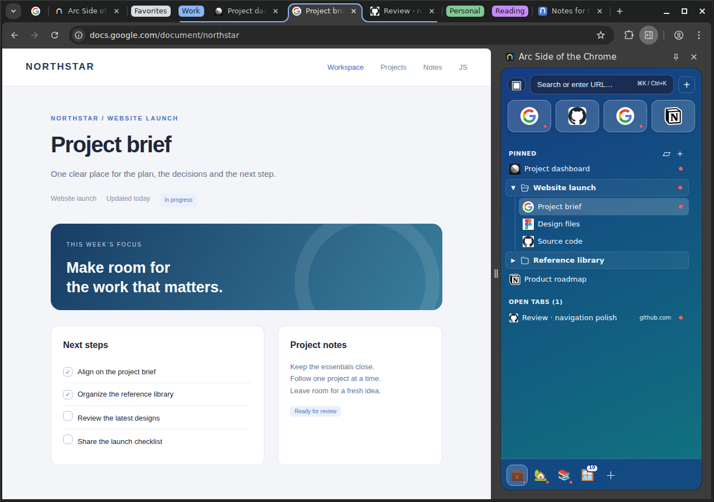
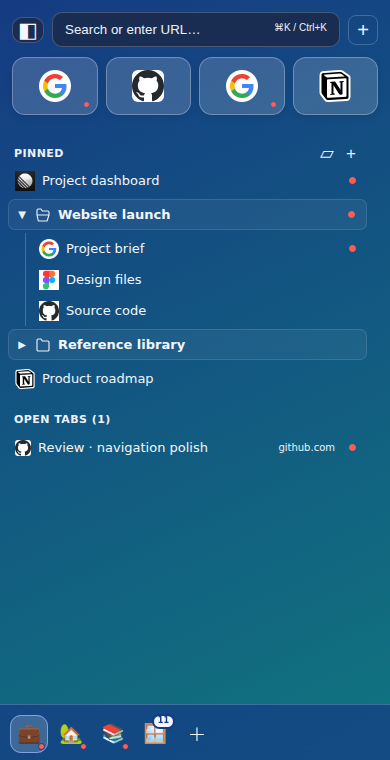
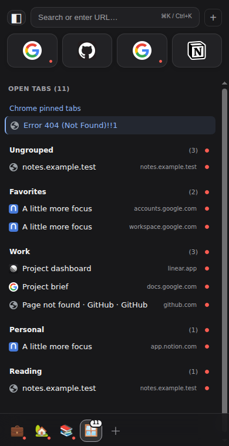
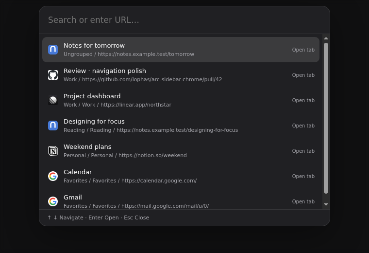
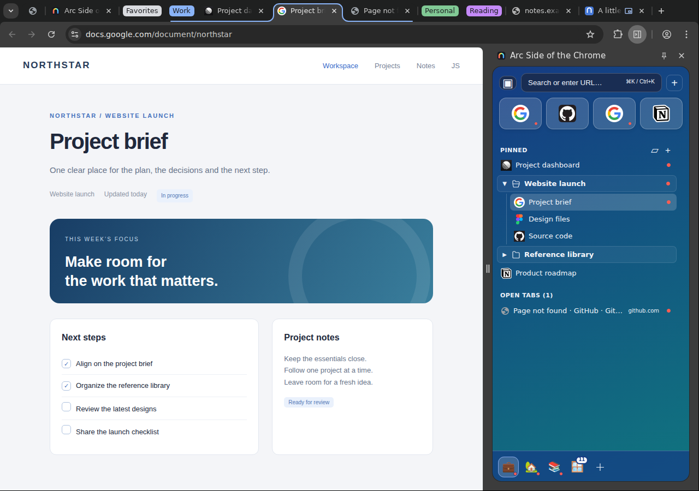
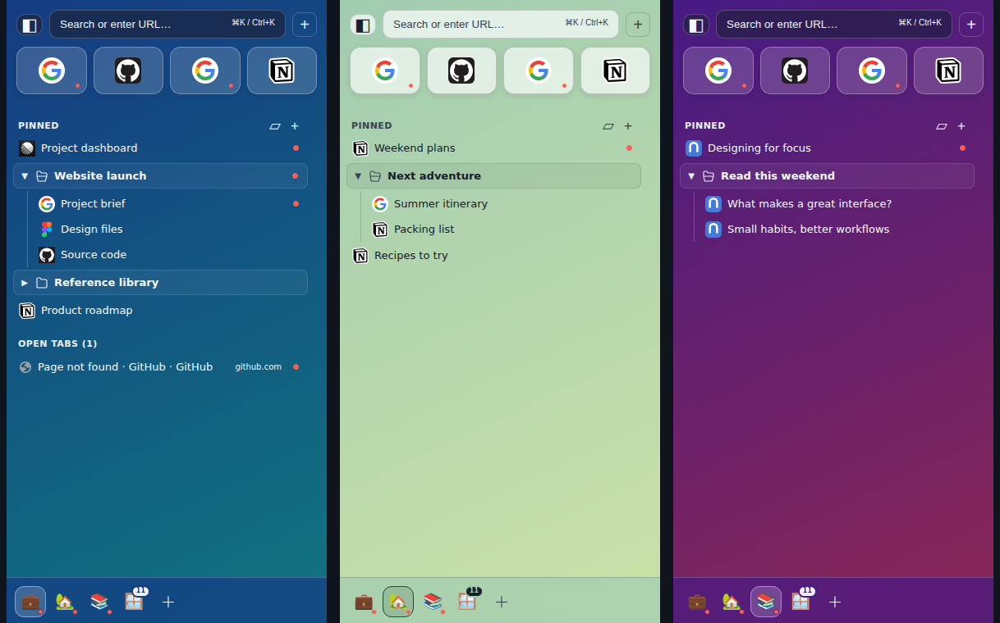
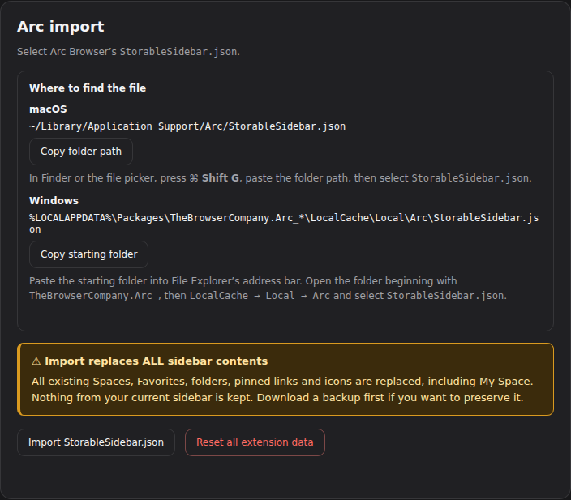
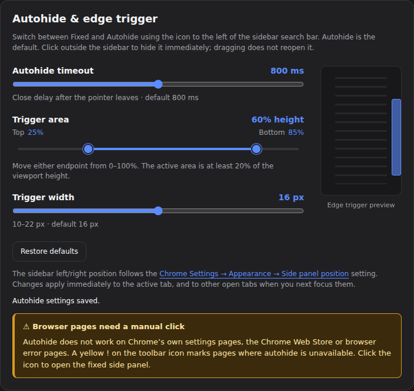
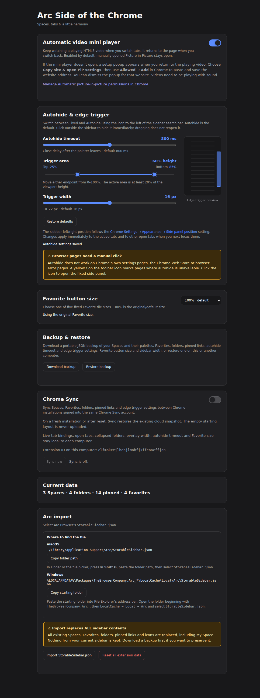

# Arc Side of the Chrome

*Spaces, tabs & a little harmony.*

## Mission

Make Chrome a calmer place to work. Give every project its own Space, keep everyday sites within reach, and move between tasks without losing your place. Bring the organization you loved in Arc Browser into the Chrome you already use.

[**Download the latest release**](https://github.com/lophas/arc-sidebar-chrome/releases/latest) · [Getting started](#getting-started) · [User guide](docs/guide.md) · [Installation](#installation)

## Why use it?

- **Work by project, not by a growing pile of tabs.** Spaces bring your saved links, folders and live work together.
- **Keep Chrome’s native tab bar useful.** Its groups, tabs and focus stay in step with your Spaces, whichever way you navigate.
- **Save your place, then close the tab.** Favorites and pinned links remain ready for the next visit.
- **Find the next thing with ⌘K / Ctrl+K.** Search saved links and open tabs together, or jump straight back to your previous tab.
- **Keep watching while you work.** Playing videos move into an automatic floating mini player when you switch tabs.
- **Move in with your existing organization.** Import all your Arc Browser Spaces, Favorites, folders and icons, then keep your setup available with Chrome Sync and backups.

### Your Spaces and Chrome’s tab bar, working together

The sidebar and Chrome’s native groups follow the same organization. Group order and colors match your Spaces; focus changes expand the active group and collapse the others. Switch tabs in Chrome’s tab bar and the sidebar selects the matching Space. Open another page from a Space’s pinned link and it stays with that project.

Use the sidebar, the native tab bar or both. Your workflow stays connected, including the additional tabs you open along the way.

### Keep the essentials. Close the clutter.

Global Favorites are always within reach. Each Space keeps its own pinned links and folders, even when their browser tabs are closed. Clicking an already-open saved link returns to that same tab, including after you navigate away from its original URL.

Additional project tabs appear below the pinned links. Drag a useful one into your saved collection, or close the Space’s working tabs together when you finish. The Open tabs view gives you a grouped overview of the whole window.

| Saved links and project tabs | All open tabs, grouped |
| --- | --- |
|  |  |

### Find any tab without breaking your flow

Press **⌘K / Ctrl+K** for recent open tabs, Favorites, pinned links, folders and Spaces. Search across Chrome windows, open a URL or search Google. A saved link and its live tab appear as one result.

**⌘K / Ctrl+K → Enter** takes you back to your previously used tab. Internal Chrome pages such as `chrome://extensions/` are searchable too.

### Let the video follow you

Switch away from a playing video and it continues in a floating **Picture-in-Picture** window. Return to its tab and it goes back into the page without restarting. Automatic PiP is enabled by default and works with compatible HTML5 players, including YouTube.

If a website needs Auto PiP permission, the extension guides you through enabling it. A mini player you open manually stays under your control.

### Recognize your workspace at a glance

Give each Space a distinct palette: Classic black, a ready-made color combination, a custom solid color or a two-color gradient. The whole sidebar follows the Space, including Favorites, search, scrollbars and the switcher. Chrome groups follow its primary color. Light and dark appearances are supported.

### Bring your Arc Browser setup with you

**Seamlessly migrate all your Spaces, Favorites, pinned links and folders from Arc Browser, with Space emojis and website icons.** Choose your `StorableSidebar.json` file in Extension options and pick up with a familiar organization.

Chrome Sync keeps your organization available across computers. Portable backups also preserve your folder layout and sidebar preferences. Import and restore replace the current contents, so download a backup first if you want to keep them.

*Screenshots show example workspaces in version 4.0.0.*

## Features in detail

| Area | What you can do |
| --- | --- |
| **Spaces and folders** | Create, rename and reorder Spaces; organize links in expandable folders; move complete folders between Spaces. At least one Space always remains. |
| **Favorites and saved links** | Reorder by dragging; move links between Favorites, Spaces and folders; edit titles and URLs; use site favicons, uploaded images or Space emojis. Leave a link title blank to refresh it from the page. |
| **Live tab navigation** | Reuse a saved link’s existing tab across navigation and browser restarts. Tabs opened from Favorites appear ungrouped at the end of the tab bar; closing an active child returns to its opener. Space links open new tabs inside their Space’s Chrome group. |
| **Native Chrome groups** | Keep Favorites first, followed by Spaces in sidebar order. Group colors follow Space palettes. Focus changes expand the active managed group; between focus changes you can open and close groups manually. |
| **Open tabs and close controls** | Browse Chrome groups in tab-bar order. Close a tab, folder’s open links, group, Space’s working tabs or all window tabs. Closing the last working tab keeps the window available. Chrome’s native pinned tabs remain read-only. |
| **Loaded and unloaded tabs** | A filled red dot means loaded; an outlined dot means unloaded from memory. Hover over a closeable dot for **× / Close**. Saved links remain after closing their tabs. |
| **Search** | Search real open tabs across windows alongside saved items, with favicons and group/Space labels. Navigate with arrow keys and Enter; use Escape to dismiss. Empty New Tab pages are omitted. |
| **Automatic mini player** | Continue compatible playing videos when switching tabs; return them to the page on return. Turn automatic PiP off in Options, or follow the per-site permission guide. |
| **Fixed or Autohide** | Switch beside search. Autohide follows Chrome’s side-panel position; choose the close delay and the edge trigger’s top, bottom and width. Click outside to hide it; unsaved editor fields are kept. |
| **Right-click pinning** | Save the current webpage or a link directly to Favorites or a Space from Chrome’s context menu. All destination selectors list Favorites first. |
| **Chrome Sync** | Sync Spaces, palettes, Favorites, folders, links, icons, order and edge trigger settings. On a fresh installation, restore the existing cloud setup before uploading any new organization. |
| **Backup and restore** | Save a portable JSON copy including custom icons, palettes, expanded/collapsed folders, sidebar mode, timeout, trigger settings, Favorite size, width and automatic PiP preference. |

### Fit the sidebar to the way you browse

Choose **Fixed** for a sidebar that stays beside your page, or **Autohide** for an overlay that appears at the edge. The toolbar button opens Fixed mode; the switch beside search returns to Autohide. Browser settings, Chrome Web Store and error pages use the toolbar button; in Autohide mode, a yellow **!** identifies pages where a manual click is needed.

The trigger controls let you keep the active area away from an embedded scrollbar. Set its top and bottom anywhere from 0–100% with a minimum 20% height, its width from 10–22 px, and the close delay from 400–1200 ms. Resize the sidebar by dragging its edge and adjust Favorite tile size from 50–150% in Options. Favorite size stays local to each computer and is included in backups.

View the full Options page

[Backup and Chrome Sync controls](docs/screenshots/backup-sync.png)

For step-by-step controls, permissions, import file paths and exact Sync/backup behavior, see the [**user guide**](docs/guide.md).

## Getting started

[Install the extension](#installation), then:

1. **Open your sidebar.** Pin the toolbar icon. Click it for Fixed mode, or move to the page edge for Autohide. Start with **🚀 My Space** and an empty Favorites collection.
2. **Save your everyday sites.** Use **+** beside search for Favorites. Use **+** or the folder button above the pinned list for links and folders. You can also right-click a webpage or link and choose **Pin to Arc Side of the Chrome**.
3. **Give each project a home.** Add Spaces with the bottom switcher. Right-click a Space to change its name, icon and palette.
4. **Navigate naturally.** Use the sidebar, Chrome’s tab bar or **⌘K / Ctrl+K**. Drag an additional open tab into the pinned list when you want to keep it.
5. **Bring in an existing setup.** Open **Extension options** in the footer to import Arc Browser data, restore a backup or enable Chrome Sync.

## Best practices

- **Use one Space per project or activity.** Keep Work, Personal and Reading separate, then add folders for related references within each.
- **Keep Favorites for genuinely shared sites.** Mail, calendar and other daily tools stay available in every Space.
- **Save links you need again; close tabs you have finished with.** Use **Close open tabs** on a Space to finish a session while keeping its saved structure ready for next time.
- **Make the previous-tab shortcut a habit.** **⌘K / Ctrl+K → Enter** is a quick way to alternate between a project tab and an ungrouped page.
- **Give Spaces distinct colors.** Use the same visual cues in the sidebar and Chrome’s groups to recognize your current context.
- **Set the trigger around your page’s controls.** Shorten or move the Autohide trigger if it overlaps a scrollbar you drag often.
- **Back up before replacing data.** Import and restore overwrite the current organization. On a new computer, enable Sync first if you want to recover your existing cloud setup.

## Installation

1. Download the ZIP from the [**latest GitHub release**](https://github.com/lophas/arc-sidebar-chrome/releases/latest).
2. Extract it to a permanent folder.
3. Open `chrome://extensions` and enable **Developer mode**.
4. Choose **Load unpacked** and select the folder containing `manifest.json`.
5. Pin **Arc Side of the Chrome** in the toolbar, then follow [Getting started](#getting-started).

### Updating

Replace the files in your existing installation folder with those from the new release, then click **Reload** on the extension’s card at `chrome://extensions`. Reload already-open webpages to apply the new version. Your saved organization and preferences remain available.

For the latest repository version, use **Code → Download ZIP** and load the extracted folder containing `manifest.json` in the same way.

## Help and project information

For setup and usage details, read the [user guide](docs/guide.md). Report problems or suggest improvements through [GitHub Issues](https://github.com/lophas/arc-sidebar-chrome/issues).

Arc Side of the Chrome is an independent extension developed entirely from scratch. It is **not affiliated with, endorsed by or sponsored by The Browser Company or Arc Browser**.

See [LICENSE](LICENSE).
